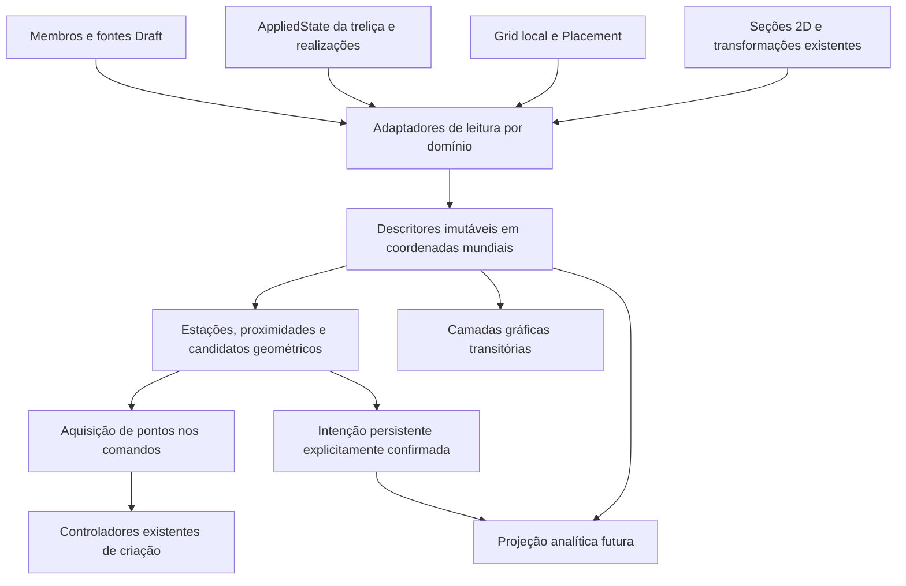

# Eixos, nós e referências estruturais — estudo arquitetural

Data: 24/10/2026. Steel Structures, branch `develop/0.7.0`.
HEAD auditado: `f303f81b76749d621e7dc58ae128fe7787a783eb`.

**GO arquitetural para uma primeira etapa de consulta e visualização aditiva de
eixos nominais e extremidades, sem persistência nova.** A engine atual comporta
essa etapa mediante adaptadores de leitura; não é necessária uma reescrita.
O GO não autoriza implementar o sistema inteiro nem equivale a aprovação de UI,
análise estrutural, commit ou publicação. As decisões humanas estão na seção 12.

**NO-GO para entregar simultaneamente associação de pontos, conectividade
analítica, snaps em sólidos ocultos e Raio X geral.** Esses recursos são viáveis
como evolução, mas têm contratos e provas próprios ainda pendentes. Um cruzamento
geométrico nunca deve produzir automaticamente uma ligação estrutural.

Esta rodada produziu somente este documento e evidências isoladas em
`test-results/structural-reference-study/`. Não alterou produção, testes existentes,
catálogos, propriedades, interfaces ou documentos FCStd do usuário. A auditoria e
consolidação de StructuralPlate continuam adiadas; sua documentação foi preservada.

## 1. Escopo, método e grau das evidências

Foram inspecionados os módulos reais de criação, membros, seções, ajustes,
Meia-esquadria, treliças, Grid e apresentação. Revisões complementares de leitura
cobriram coordenadas/seções, topologia e Draft/Coin. Os caminhos e símbolos abaixo
se referem ao HEAD indicado, não a uma arquitetura suposta.

Como contexto de compatibilidade, foram consultados os relatórios
[Aparo Controlado](MEMBER_MITER_CONTROLLED_TRIM.md) e
[fechamento do Aparo Controlado](MEMBER_MITER_CONTROLLED_TRIM_CLOSURE.md), além dos
contratos de código/testes de referência e ciclo de vida de treliças. A aprovação
manual anterior de Meia-esquadria é preservada; não é aprovação deste sistema novo.

As seguintes categorias não devem ser confundidas:

- **Existente:** comportamento encontrado no código; pode ter limites explícitos.
- **Verificado nesta rodada:** leitura, 214 testes direcionados e duas execuções
  pequenas no FreeCAD 1.1.4, descritas na seção 11.
- **Proposto:** contratos e etapas deste relatório, ainda não implementados.
- **Pendente:** comportamento que precisa de prova antes de anunciar suporte.

A fonte instalada do Draft foi lida em
`C:/Users/marco/Desktop/FREECAD/FreeCAD_1.1.4-Windows-x86_64-py311/Mod/Draft/`.
Ela é a referência para os detalhes de integração com a versão alvo. Os links
upstream são úteis para manutenção, mas `main` não é um pin da versão instalada.
Foram consultadas também fontes primárias de FreeCAD e Coin, citadas junto aos
assuntos correspondentes. Não houve benchmark de produtos comerciais, instalação
de dependências, alteração do Snapper global ou execução da suíte completa.

## 2. Inventário e mapa de impacto

Os caminhos desta tabela são relativos a `freecad/SteelStructures/`. As linhas
são localizadores do HEAD auditado; os símbolos são a referência durável.

| Área e localização | Responsabilidade existente | Reaproveitamento / risco |
| --- | --- | --- |
| `commands.py:170,258` | Criar Membro e Criar Pilar; pilar deriva da infraestrutura de membro | Manter comandos/transações; integrar referências por aquisição de pontos em etapa posterior |
| `interactive/draft_member_tool.py:31,219`; `draft_column_tool.py:31,115` | Subclasses de `Draft Line`, eventos, entrada numérica, continue e conclusão | Snap estrutural precisa chegar antes do ponto ser consumido; não trocar o resultado apenas depois de `super().action()` |
| `interactive/member_controller.py:96` | Criação, revalidação de SourceAxis, opção de vínculo e rollback | Reusar commit de criação; não fazer renderer criar objetos |
| `member.py:163,253,515` | Entradas paramétricas, Shape local, Placement, execute e saídas efetivas | Fonte do eixo nominal e autoridade sobre geometria física; leitura não dispara execute |
| `member.py:192,210,733,805` | Sincronização de Placement/pontos/roll, replay e restauração | Não duplicar callbacks nem reconstruir orientação preservada |
| `member_axis_source.py:25,64,75` | Draft Line única, Edge1, extremos ordenados e pais | Adaptador especializado já existente; não ampliar AxisSource implicitamente |
| `profile_catalog.py`; `profiles/models.py` | Identidade de perfil, dimensões, propriedades e origem de catálogo | Perfil por chave/referência, não pelo Label exibido; nenhum catálogo novo |
| `profiles/geometry.py:248`; `profiles/freecad_geometry.py` | Contorno 2D com linhas/arcos/vazios e adaptação Part | Fonte de esquema real da seção; não reconstruir pelo envelope |
| `profiles/insertion.py`; `profiles/effective_properties.py:321` | Referências semânticas de inserção e integrais geométricas de seção | Reusar cálculo de centroide; datum da seção pode diferir do centroide físico |
| `assemblies/models.py:62`; `transforms.py:14,85`; `resolver.py` | Frames, reflexão/rotação 2D e componentes de conjuntos | Preservar ordem transformação → inserção → offset; não converter espelho em roll |
| `assemblies/distribution.py:55`; `attachment.py:42` | Estações nominais e seção transformada na inserção | Há reutilização matemática, mas Count atual conta estações, não intervalos |
| `member_adjustment_geometry.py:14,58,69,91` | Eixo, projeções, interseção eixo/plano e limites axiais | Núcleo puro aproveitável; não assumir que toda primitiva usa segmentos finitos |
| `member_adjustment_reference.py:53,107` | Faces/arestas de referência, ciclos de dependência | Coordenadas de subshape exigem contexto de ocorrência; ver seção 4 |
| `member_plane_cut.py`; `member_batch.py` | Clipping e avaliação detached do executor existente | Não chamar OCC para obter dois pontos de eixo; preservar pipeline físico |
| `interactive/member_adjustment_controller.py`; `member_adjustment_preview.py` | Validação/commit de ajuste e preview Coin sem alterar Visibility | Referência de cleanup; máscara simultânea exige arbitragem |
| `member_miter_geometry.py`; `interactive/member_miter_controller.py:35,137` | Encontro nominal, escolhas/consentimento, candidatos físicos e commit bilateral | Fonte de um contrato global já usado; não transformar solver de meia-esquadria em detector universal de nós |
| `interactive/member_miter_preview.py`; `member_miter_task_panel.py` | Preview bilateral, observer/timer, troca de vista e limpeza | Preservar autorização global e assinatura material; novo modo não toca os participantes |
| `trusses/models.py:37,94,104` | TopologyGraph → PhysicalRun → RealizationItem | Topologia já separada do físico; adaptar essa fonte |
| `trusses/patterns.py`; `runs.py`; `realization.py:28` | Geração de nós/arestas, continuidade e frames | Cruzamentos Connected/Disconnected já têm intenção explícita |
| `truss.py:169,247,699,834` | AppliedState, bindings, replay e identidade dos filhos | Estado aceito difere de edição Pending/Conflict; não inferir verdade dos parâmetros solicitados |
| `trusses/edit_session.py`; `editing.py:62,262` | Rascunho, revisão e alteração autorizada de topologia | Não usar normalização Custom como algoritmo global de descoberta |
| `truss_reference.py:90`; `truss_edge_snapshot.py:10,54` | Dependências de contêineres, Draft e captura de arestas por caminho | Reusar validação de ocorrência; snapshot não cria associatividade geral |
| `grid_geometry.py:235,330`; `grid.py:250` | Eixos/interseções locais e geração paramétrica do Grid | `nearest_intersection` existe, mas não tem consumidor de snap na criação atual |
| `grid_view.py:163,254,301` | Coin local no RootNode, pontos e rótulos | Bom exemplo de desenho derivado sem objetos por ponto; keys de Grid não são UUIDs |
| `member.py:840`; `truss.py:580,612` | ViewProvider simples do membro; treliça propaga Visibility aos filhos | Membro não tem modo de eixo; ocultar owner da treliça por propriedade tem efeitos persistentes |
| `interactive/member_creation_preview.py:23`; `truss_controller.py:299` | Preview temporário de criação / preview Coin da treliça | Padrões distintos; não presumir que todo preview atual é só scenegraph |
| `trusses/editor_snapping.py`; `interactive/truss_topology_editor.py:219` | Snap local 2D com prioridade e tolerância de tela | Referência de UX/ranking; não é snap 3D global |

### Dependências recomendadas



O fluxo de leitura não retorna alterações para `execute`, catálogo, topologia ou
Shape. A seta para criação só existe após ação explícita do usuário. A projeção
analítica terá autoridade e validação próprias, sem transformar a camada gráfica
em fonte de verdade. Os nomes dos blocos são responsabilidades, **não nomes novos
obrigatórios de arquivos/classes**. A localização exata deve ser decidida ao
implementar, respeitando núcleos puros, adaptadores FreeCAD e `interactive/`.

## 3. Modelo físico, referencial e analítico

| Conceito | Definição / autoridade | O que não implica |
| --- | --- | --- |
| Eixo nominal ou de referência | Segmento orientado Start→End que conduz a construção do membro, antes de extensões/ajustes | Não é necessariamente centroide, aresta da Shape ou eixo de cálculo |
| Eixo geométrico centroidal | Linha paralela ao eixo nominal pelo centroide de área da seção representada, após inserção, transformação e offsets | Não é COM do sólido cortado; não define centro de torção ou eixos principais |
| Eixo analítico futuro | Linha escolhida no modelo de análise, com política de seção/material e ligações explícitas | Não nasce de mostrar eixos, trocar modo Detailed/Simplified ou executar meia-esquadria |
| Ponto auxiliar | Localização derivada ou declarada, com domínio e regra: extremo, fração, distância, Grid etc. | Não tem graus de liberdade nem conectividade estrutural por si só |
| Nó geométrico candidato | Relação de encontro/proximidade entre referências, com participantes, resíduos e parâmetros | Não funde membros nem declara ligação, contato, solda ou continuidade |
| Nó estrutural confirmado | Entidade de conectividade aceita no modelo estrutural, com participantes e intenção explicitamente registrada | Não deve herdar rigidez/release padrão só pela coincidência geométrica |
| Barra física | Membro/sólido fabricável ou componente de conjunto, com cortes e material físico | Não corresponde obrigatoriamente a um único elemento de análise |
| Barra/elemento analítico | Segmento idealizado entre nós analíticos, com seção, orientação, material e condições de extremidade | Pode representar parte de uma peça contínua ou um conjunto validado; não modifica o sólido |

Os nós já presentes no `TopologyGraph` da treliça são **conectividade geométrica
declarada da geração**. Constituem ótima proveniência para análise futura, mas
não certificam articulação, rigidez, excentricidade ou propriedades de ligação.
`trusses/connections.py` já separa intenção física de ligação, com opções como
`GeometricOnly`/`Unspecified`; não é um modelo de releases analíticos.

Exemplos obrigatórios de distinção:

- Dois eixos cruzados em X podem permanecer desconectados. As próprias treliças
  já distinguem Connected/Disconnected em `patterns.py`.
- Um ponto interno usado para criar uma diagonal não divide o sólido da barra
  contínua. A futura malha analítica pode dividir sua representação em elementos.
- Dois perfis paralelos de um conjunto têm eixos físicos separados. Ação composta
  exige política de ligação/interconectores; não somar rigidez automaticamente.
- Duas faces coincidentes depois da meia-esquadria provam compatibilidade física
  naquele algoritmo, não propriedades mecânicas de uma ligação.
- Contato barra/chapa não cria automaticamente nó de shell ou acoplamento rígido.

### Nominal versus físico após cortes

Manter três referências distintas: extremo nominal; ponto efetivo de limite no
eixo de inserção; face/contorno físico. Para PlaneCut oblíquo a face ocupa várias
estações axiais. `EffectiveStartPoint/EffectiveEndPoint` não são a lista dos
vértices da tampa nem garantem que existe material no ponto — o eixo pode passar
por vazio de seção tubular ou ficar fora de seção com inserção excêntrica.

O Aparo Controlado preserva Start/End e grava o offset/plano fixo nos slots
existentes. Portanto um extremo nominal pode estar fora do sólido final.
O futuro snap deve identificar claramente “nominal” versus “físico”; nunca
substituir silenciosamente um pelo outro. O leitor pode expor o estado do ajuste
sem refazer corte. Medir contorno físico só quando uma ferramenta pedir isso.

### Excentricidades e análise futura

Reservar uma relação explícita entre ponto de referência, eixo centroidal e nó
analítico. Um vetor de excentricidade deve declarar origem/destino, frame e sinal
(`p_destino − p_origem`), além de regra geométrica ou valor manual. Uma relação
geométrica de offset **não é um vínculo rígido**. O futuro modelo analítico poderá
representar rigid offsets/links, liberações por extremidade e acoplamentos, mediante
decisão de engenharia e sem mover a peça física para fazer os eixos coincidirem.

Seção, centroide adotado para análise, eixos principais, Ixy, centro de torção,
material e comportamento de conjuntos são dados adicionais. O integrador atual
de seção fornece área, centroide e Ix/Iy; isso não constitui cadastro analítico
completo. Uma troca de representação física Detailed/Simplified não deve mudar
automaticamente o modelo analítico aprovado.

Para shells, prever descritores de superfície média, normal, espessura, contorno
e relações barra/superfície como domínio separado. Não forçar chapa em
`TopologyEdge`, nem reaproveitar FaceN como identidade analítica estável.
Esta é apenas uma fronteira de extensão; nenhuma auditoria/consolidação de
StructuralPlate ou seleção de solver foi feita.

## 4. Contratos propostos de dados e coordenadas

### 4.1 Membro independente: leitura direta do eixo nominal

Para um membro válido e recomputado, sem ocorrência Link/array escalada:

```text
a = StartPoint; b = EndPoint                 # coordenadas no espaço do pai
L = ||b-a||; d = (b-a)/L
H = getGlobalPlacement() * inverse(Placement) # pai → mundo
R = rotação de getGlobalPlacement()          # frame real da seção → mundo
A = H(a); B = H(b)
Pnom(s) = H(a + s*d),  0 <= s <= L
Pnom_fraction(f) = Pnom(f*L),  0 <= f <= 1
s0 = dot(EffectiveStartPoint-a, d)
Pshape(x,y,z) = H(EffectiveStartPoint) + R*(x,y,z)
estação nominal correspondente à Shape local = s0 + z
```

Esse contrato já tem precedente em `member_miter_controller.parent_placement`.
`Placement.Base` segue `EffectiveStartPoint`; não é o início nominal. Os comentários
antigos que chamam Start/End de “global” só são suficientes na raiz. Não aplicar
Placement inteiro a Start/End. Para pontos da Shape, substituir a Placement da
cópia por `getGlobalPlacement()` é o padrão atual do preview global da miter;
não aplicar a mesma transformação duas vezes.

Validar finitude, L positivo, frame ortonormal e `R*(0,0,1)` paralelo a B−A com
o mesmo sentido. O frame padrão é X largura, Y altura, Z longitudinal; a rotação
completa preservada pelo usuário prevalece sobre reconstrução por direção+roll.
O serviço não redefine frame para membros verticais ou quase verticais.

**Limites:** Linked usa `resolve_axis_source()` e grava seus pontos resolvidos
mundiais em Start/End. Linked sob pai transformado não tem o mesmo contrato
garantido que Independent; deve retornar domínio não suportado até prova e decisão
específicas. Ajustes associativos sob pai transformado já têm restrição na miter.
Não corrigir esses limites incidentalmente na primeira etapa de leitura.

### 4.2 Centroide e seção orientada

`SectionGeometry2D.origin` é datum; não é sempre o centroide do contorno físico.
O código já oferece `section_geometric_properties()`, que integra linhas/arcos e
vazios. Reusar esse cálculo, nunca o centro do bounding box nem o COM da peça
inteira cortada. Catalogar a base do resultado: representação Detailed/Simplified,
datum publicado ou centroide geométrico calculado.

Se C é o centroide da seção já transformada, Q a referência de inserção também
transformada e O=(OffsetX,OffsetY), a linha centroidal geométrica é:

```text
Pcentroid(s) = Pnom(s) + R * (Cx-Qx+Ox, Cy-Qy+Oy, 0)
Psection(s, p) = Pnom(s) + R * (T(p)-Q+O, 0)
```

T é `AssemblySectionTransform`, quando existir. Reusar `transform_section`, que
transforma contornos **e referências semânticas**, inclusive envelope_center.
Espelhar muda handedness da seção; o frame 3D continua ortonormal destro. Não
inferir a orientação de cantoneira/U por um ícone genérico nem assumir simetria.

Para duplos, distinguir eixo do run lógico, eixos de inserção dos componentes,
centroides individuais e eventual centroide geométrico agregado ponderado por
área. O agregado é informação geométrica, não certificação de seção composta.
`trusses/assemblies.py` já usa `global = nominal + R_role*(d + T(p-q))`;
seu deslocamento não deve ser aplicado novamente ao componente já realizado.

### 4.3 Outros domínios e ocorrências

| Fonte | Espaço de entrada | Conversão e precaução |
| --- | --- | --- |
| Draft Line | Start/End já incorporam Placement próprio | `resolve_axis_source`: aplicar apenas pais; não generalizar para qualquer Wire |
| Grid | `IntersectionPoints` e geometria XY locais | Aplicar getGlobalPlacement uma vez; linhas X/Y seguem convenção própria do Grid |
| Treliça aceita | Nós locais + config/frame aceitos em AppliedState | Usar frame de `trusses.realization`, sem misturar config pendente; RealizationItem já tem start_global/end_global |
| Filho de treliça | Membro físico mais owner/GenerationKey | Consultar eixo físico como tal; para nó lógico consultar owner, não inferir do filho |
| Subshape selecionado | Depende da raiz e caminho de ocorrência | Resolver caminho completo, declarar frame obtido e testar; nome EdgeN sozinho não transporta contexto |
| App::Link/array/escala | Ocorrência pode diferir do objeto fonte | Fora do MVP; identidade deve reservar caminho/ocorrência, sem prometer suporte |

**Achado nativo importante:** com dois App::Part transformados,
`member.getSubObject('Vertex1')` não coincidiu com o vértice mundial.
`outer.getSubObject('Inner.StructuralMember.Vertex1')` coincidiu. Assim, o comentário
de `member_adjustment_reference.py` sobre getSubObject global não pode ser
generalizado para qualquer hierarquia. `truss_edge_snapshot.py` já preserva a raiz
e o caminho de seleção; `truss_reference.py` aplica uma conversão própria no caso
de retângulo. A nova camada precisa explicitar o frame de cada adaptador e não
unificar essas rotas por suposição. Nenhuma ferramenta existente foi corrigida.

`getGlobalPlacement()` é útil para uma ocorrência geométrica suportada, mas
não resolve sozinho a identidade/escala de App::Link. A documentação oficial
mostra a distinção entre Placement e Placement global; a prova local delimita
o comportamento aqui usado. [Placement, FreeCAD](https://github.com/FreeCAD/FreeCAD-documentation/blob/main/wiki/Placement.md).

### 4.4 Descritores imutáveis e frescor

Propor valores de leitura, sem prescrever classes/arquivos:

| Descritor | Conteúdo mínimo |
| --- | --- |
| Referência de origem | Documento vivo, owner, domínio, chave semântica, caminho de ocorrência suportado; proveniência |
| Eixo resolvido | A/B mundiais, L, direção, frame real, origem nominal e efetiva, unidades, revisão/frescor |
| Estação | Tipo da regra, parâmetro, s nominal, posição mundial, domínio do eixo, chave do slot |
| Relação candidata | Participantes e estações, dois pontos de aproximação, distância residual, classificação, tolerâncias usadas |
| Referência resolvida | Resultado + status: válida, pendente, ausente, fora de domínio, ambígua ou não suportada |
| Primitiva gráfica | Coordenadas, classe semântica, identidade de origem, estado de destaque; sem autoridade paramétrica |

Coordenadas numéricas em mm; frações adimensionais; ângulos públicos compatíveis
com graus existentes. Quantities/unidades são convertidas na borda do adaptador.
Não guardar Qt, ViewObject ou Coin dentro de valores puros. Operações conceituais:
resolver eixo/frame; local↔mundo; ponto por estação/fração; relações entre segmentos;
candidatos; pontos disponíveis para aquisição; primitivas de desenho.

Resolver não chama `doc.recompute()`, não abre transação, não conserta referência
ausente e não aplica alterações pendentes da treliça. Recompute/Undo/Redo invalidam
o cache; o consumidor readquire os objetos e confirma revisão antes de agir.
Pode-se desenhar último estado aceito como **desatualizado**, mas não aceitá-lo
silenciosamente em snap/criação vinculada. Alteração só visual invalida desenho,
não geometria/topologia; mudanças de Placement dos pais invalidam descendentes
mesmo quando State do filho não foi tocado.

### 4.5 Identidade: derivações versus intenção persistente

Na sessão, usar identidade de documento vivo + objeto validado + domínio/chave
de referência. `Name` ajuda a readquirir objeto no documento; Label é apresentação,
e `id()` Python não sobrevive a replay/reabertura. Não usar coordenadas arredondadas
como identidade de nó. `Name` isolado também não é identidade global nem protege
contra exclusão/recriação/cópia; invalidar gerações de cache nesses eventos.

Para vínculo persistente futuro, preferir Link ao owner dentro do documento mais
chave semântica/slot e regra de estação em um objeto de referências dedicado.
Não persistir apenas string DocumentName+Label. Uma cópia deve remapear Links;
duplicar arquivo não transforma referências internas em relações cross-document.
Referências entre documentos ficam fora do primeiro contrato. UUIDs de intenção
podem pertencer aos novos slots/relações, sem acrescentar UUID a todos os membros
legados. Política de cópia/exportação desses UUIDs precisa aprovação específica.

Treliças já oferecem owner + GenerationKey/RunKey/ComponentKey e bindings do
AppliedState. Nós manuais usam UUID; presets têm keys ligadas às estações. Incluir
owner evita colisão entre cópias. Remover/repanelizar nó pode invalidar a chave;
referência órfã deve ser diagnosticada, nunca religada ao mais próximo.
Interconectores guardam extremos de run como proveniência: isso não os torna
incidentes nesses nós físicos.

`trusses/serialization.py` aceita schemas 1–5 e rejeita versões desconhecidas;
a versão emitida depende dos recursos usados. O leitor deve usar esse decodificador
e preservar a versão existente. Copiar treliça já remapeia filhos/bindings; não
substituir esse mecanismo por identidade global deduzida de coordenadas.

Grid usa keys derivadas de labels/índices. Renomear ou inserir eixos pode mudar seu
significado. Oferecer primeiro snapshot; vínculos estáveis exigem identidade de
eixo explícita ou invalidação conservadora da estrutura da lista. Não introduzir
migração de Grid para viabilizar apenas a visualização.

### 4.6 Tolerâncias e candidatos de encontro

Separar quatro contratos, sem alterar constantes dos algoritmos existentes:

1. **Numérico:** para o novo resolvedor de segmentos, proposta inicial de base
   linear 1e−7 mm, consistente com AxisGeometry/AxisSource, e guarda relativa
   explícita para escala/representabilidade. Usar diferenças em origem próxima;
   se a precisão disponível não sustenta a tolerância solicitada, retornar
   mal-condicionado. Não relaxar arbitrariamente até “achar” interseção.
2. **Angular:** parâmetro adimensional separado para paralelismo de vetores
   normalizados; proposta inicial 1e−10 para norma do produto vetorial, a confirmar
   nos testes de condicionamento. Não comparar ângulo com tolerância em mm.
3. **Proximidade geométrica do projeto:** valor em mm informado ao usuário e
   guardado na operação/revisão. Não é folga de fabricação nem tolerância OCC.
   Pode gerar candidato, nunca confirmar conexão. Valor padrão requer aprovação.
4. **Aquisição na tela:** raio em pixels lógicos, com conversão DPR/projeção;
   não usar zoom para decidir coincidência estrutural.

Cada resultado registra tolerâncias e resíduos. Esta proposta numérica não é
certificação de precisão de um futuro solver. As tolerâncias 1e−7/1e−6/1e−8 já
usadas por módulos distintos devem permanecer locais até revisão deliberada.

Classificar endpoint–endpoint, endpoint–interior, interior–interior, proximidade
de retas reversas, paralelas separadas e sobreposição colinear. Operar primeiro
sobre **segmentos finitos**; encontro de prolongamentos tem classificação própria
e não é nó no membro. Para proximidade, devolver pontos nos dois eixos e distância,
sem inventar um ponto médio como conexão confirmada. Sobreposição colinear é um
intervalo/relação, não um nó único. Encontrar candidatos em 3D; não reduzir a
coincidência à projeção da câmera.

Não usar união transitiva ingênua: se A está perto de B e B de C, A/C podem estar
fora da tolerância. Grupos de candidatos precisam verificar todos os participantes
contra a política declarada, conservar resíduos e permitir revisão explícita.
O grafo Custom da treliça tem normalização que mescla nós/divide arestas; ela não
deve ser chamada para “descobrir” conexões na estrutura geral.

## 5. Alternativas arquiteturais e recomendação

| Alternativa | Vantagem | Risco / decisão |
| --- | --- | --- |
| Draft Line/Point persistente para cada eixo/nó | Seleção e algumas referências nativas prontas | Duplicação de fonte, árvore/histórico grandes, ciclos e sincronização; rejeitada como base |
| Propriedades e modos novos em todos os membros | Apresentação local no ViewProvider | Migração/restore em massa, acoplamento com geração e múltiplos VPs; desnecessária para MVP |
| Serviço de leitura + núcleo puro + camadas transitórias | Reaproveita verdade existente, caches descartáveis, sem schema legado | Precisa adaptadores de domínio e gestão explícita de viewport; **recomendada** |
| Modelo analítico persistente como nova verdade desde já | Centraliza topologia futura | Exige decisões de conectividade, material, releases e sincronização ainda ausentes; adiar |
| Somente overlays por comando sem serviço compartilhado | Primeiro desenho rápido | Repete coordenadas/snaps/identidade e dificulta coerência; usar só como prova técnica |

Recomendação: uma camada central **de consulta e resolução**, independente de
painéis e dos controladores de ajuste. Operações puras recebem valores; adaptadores
resolvem FreeCAD; renderer recebe primitivas; aquisição de pontos recebe candidatos
e retorna escolha/proveniência. Não importar GUI para cálculos puros e não exigir
OCC para eixo/extremos/divisões.

Não extrair compulsoriamente helpers de módulos funcionais nesta fase. Na etapa
de implementação, pequenas interfaces de leitura podem reutilizar tipos existentes
(`AxisGeometry`, frames de assembly, TopologyGraph, SectionGeometry2D). Se promover
um helper privado para compartilhamento, fazê-lo em alteração focal e coberta por
regressões. Não criar uma segunda lógica de seção, clipping ou frame.

## 6. Pontos paramétricos e snaps

### 6.1 Semântica de divisão e estações

O domínio padrão proposto é o **segmento nominal orientado**, explicitamente
identificado no painel. Cortes/extensões não mudam a divisão nominal. Usar um
domínio físico ou centroidal exige opção e regra próprias; não trocar com o preset.

| Operação | Regra | Efeito de mudança de comprimento |
| --- | --- | --- |
| Dividir em N intervalos | N inteiro ≥1; internos s=kL/N, k=1…N−1 | Frações mantidas; N=1 gera zero pontos internos |
| Distância X do início | s=X; X finito e ≥0 | Distância de Start constante |
| Distância X do fim | s=L−X; X finito e ≥0 | Distância de End constante |
| Lista de distâncias | Regras explícitas por slot; uma origem escolhida ou declarada em cada regra | Cada slot conserva sua regra e identidade |
| Ponto temporário | Mesma matemática, somente sessão/cache | Desaparece ao encerrar o escopo; sem Undo de criação |
| Ponto persistente vinculado | Intenção persistida com Link/slot/regra | Reavalia após fonte, com estado inválido se sair do domínio |

Distância maior que L é fora de domínio, sem clamp nem extrapolação silenciosa.
Extremos 0/L são aliases semânticos dos extremos, não pontos internos duplicados.
Distâncias repetidas podem compartilhar marcador visual, mas não fundir slots
persistentes sem decisão. Distinguir lista de posições absolutas de lista de
incrementos; recomenda-se começar só com posições absolutas e mostrar estações
resolvidas antes de aceitar. Trocar Start/End do membro altera a orientação da
regra e precisa ser diagnosticado, não reinterpretado pelo ponto mais próximo.

`assemblies/distribution.py` já faz distribuição, mas Count significa estações
incluindo bordas. N intervalos corresponde a N+1 estações totais e N−1 internas;
não reutilizar diretamente a UI/semântica dos interconectores. Limites de recurso
devem ser explícitos e separar custo de renderização de limites geométricos.

**Nenhuma dessas operações divide o sólido.** Acrescentar nó ao grafo de treliça
seria outra operação, via editor/candidato validado/aplicação atômica. Referências
auxiliares não editam filhos nem regeneram runs automaticamente.

### 6.2 Persistência mínima futura

Derivar em runtime extremos, estações temporárias, frames, centroides, candidatos,
índices espaciais e primitivas gráficas. Persistir somente intenção criada pelo
usuário: conjunto de regras de pontos, referências consumidas e relações
confirmadas. Coordenadas calculadas são saídas/cache, não cópia concorrente do eixo.

Alternativa recomendada para a fase persistente: objeto de conjunto de referências
por escopo/owner, com Links explícitos e slots estáveis, não um objeto por marcador.
Se usar payload JSON para regras heterogêneas, versioná-lo e validá-lo; os Links
devem continuar sendo propriedades FreeCAD para recompute/cópia/remoção, não nomes
escondidos no JSON. Uma alternativa com propriedades tipadas por regra deve ser
comparada pelo volume esperado, legibilidade e custo de migração antes de escolher.
Não armazenar intenção persistente em ViewProvider, preferência global ou arquivo
externo obrigatório ao FCStd.

### 6.3 Caminho real do Draft 1.1.4

A inspeção da instalação encontrou em `draftguitools/gui_snapper.py`:
`snap` (~238), consulta `getObjectsInfo` (~318), `snapToObject` (~356) e
`snapToSpecials` (~1111). O protocolo `SnapPoints` existe, mas usa
`obj.Placement.multVec(p)` e depende do modo Special e do caminho de objeto
selecionável com Shape não nula atingido sob o cursor. Logo não resolve, sozinho,
pontos em eixos ocultos nem todas as hierarquias. Coin transitório não vira
automaticamente Component FreeCAD. [Fonte upstream do Snapper](https://github.com/FreeCAD/FreeCAD/blob/main/src/Mod/Draft/draftguitools/gui_snapper.py).

`gui_tool_utils.get_point` (~229) coordena modificadores, working plane, afinidade,
UI numérica e `Gui.Snapper`. `gui_lines.Line.action` (~95) chama essa função
diretamente; não há ali um método virtual de aquisição que baste sobrescrever.
Usar `Snapper.getPoint(callback)` em paralelo ao Line ativo cria outra aquisição
e não é integração segura por si só. [Fonte upstream de Line](https://github.com/FreeCAD/FreeCAD/blob/main/src/Mod/Draft/draftguitools/gui_lines.py).

### 6.4 Integração recomendada, depois do MVP visual

Criar um resolvedor de candidatos independente do desenho, consultado apenas pelo
adaptador dos comandos Steel Structures. O resultado inclui posição mundial,
origem, regra, distância em tela, profundidade e status. Uma escolha temporária não
cria vínculo. Antes do clique, confirmar a mesma revisão que gerou o destaque;
fonte alterada exige resolver novamente e mostrar o ponto atual.

A aquisição deverá preservar numérico, working plane, Ctrl/Shift, continue,
SourceAxis e cancelamento. Entrada numérica explícita tem prioridade. Uma restrição
que projeta um ponto para fora da referência deve produzir ponto livre/snapshot
ou exigir resolução do conflito; nunca persistir um vínculo falso ao ponto original.
Quando vários candidatos competem, mostrar domínio/owner, permitir alternância e
manter desempate estável. Prioridade inicial proposta: referência explicitamente
selecionada; extremo/nó declarado; ponto auxiliar; midpoint; projeção no eixo.
O ranking entre Draft e estrutural deve respeitar o modo ativo e ser aprovado
por UX, sem capturar todo clique da viewport.

Prova necessária: adaptar somente os ramos de evento de aquisição das subclasses,
antes de `node.append`, ou oferecer aquisição estrutural explicitamente ativada.
Escolher o menor caminho que mantenha os contratos nativos, sem copiar todo Draft
Line. **Não monkeypatch** `Gui.Snapper`, `gui_tool_utils.getPoint` ou módulos Draft.
Não anunciar provider plugável inexistente. `SnapPoints` pode ser interoperabilidade
limitada posterior em objetos apropriados, não fundamento da arquitetura.

Na primeira integração, criação consome **snapshot mundial** e continua gerando
membro Independent. Vínculo a pontos estruturais é uma fase separada: dois
descritores de extremidade, dependências/ciclos, política de edição manual,
desvincular, fonte removida, Undo/cópia/restauração. Não passar objetos novos por
AxisSource fingindo que são Draft Line. Uma futura fonte de eixo dedicada pode
evitar migração de todos os membros, mas exige suporte explícito no resolvedor;
alternativamente novas propriedades opcionais de endpoints no membro exigem
auditoria de schema própria. Nenhuma alternativa foi implementada.

## 7. Renderização e modos de visualização

### 7.1 Camadas e presets propostos

Camadas independentes: eixos; extremos/nós declarados/candidatos; auxiliares;
físico translúcido; esquemas de seção; rótulos. Preset é configuração dessas
camadas, não alteração da definição paramétrica. Permitir distinguir candidato
de nó confirmado por símbolo, além de cor.

| Preset | Físico do escopo | Referências | Condição de entrega |
| --- | --- | --- | --- |
| Físico | Aparência atual intacta | Camadas desligadas por padrão; sobreposição aditiva opcional | MVP pode oferecer apenas essa sobreposição de eixos/extremos |
| Eixos e Nós | Mascarado transitoriamente | Nominais, extremos e nós escolhidos; rótulos sob demanda | Exige seleção/aquisição de referências sem depender de sólidos visíveis |
| Eixos + Raio X | Cópia/override transitório translúcido | Eixos destacados com política de profundidade | Exige árbitro de máscaras, custo medido e restauração multi-view |
| Esquemático | Mascarado ou translúcido conforme opção explícita | Eixos e contornos reais de seção orientados; perfil opcional | Exige frame/inserção/duplos corretos e política de escala indicada |

Escopo inicial: membros elegíveis do documento, seleção ou conjunto declarado.
Objetos externos à bancada permanecem como estão; não alterar suas propriedades
para aplicar um preset. “Apenas eixos” significa, inicialmente, apenas eixos dos
participantes do escopo. Ocultar também contexto externo precisa opção posterior
e máscara com a mesma garantia de restauração, nunca uma varredura que grave
Visibility de todos os objetos.

### 7.2 Comparação de mecanismos

| Mecanismo | Uso apropriado | Limite |
| --- | --- | --- |
| ViewProvider por membro | Modo nativo de apresentação individual, integração selecionável futura | Altera todos os VPs/restore; seleção sem Shape precisa contrato; não necessário no MVP |
| Ramo Coin na cena por vista | Desenho agregado derivado, descarte simples, sem objetos de documento | Ownership, eventos e identificação para picking precisam implementação explícita |
| Ramo no RootNode de objeto | Referências locais como no Grid | Frame e visibilidade dependem da posição no scenegraph; Grid sincroniza seu SoSwitch explicitamente; não basta para eixos com físico oculto |
| Objeto Part temporário | Preview já usado pela criação | Tem ciclo de documento; não adotar um helper por ponto/eixo |
| SoAnnotation / HUD | Marcador ativo e informação focal | Desenhar tudo acima da cena elimina profundidade; não serve como política geral |
| Override global de material/display | Implementação superficial curta | Pode atingir objetos externos e seleções; rejeitado para Raio X |

Recomendação: renderer transitório agregado, separado do índice de aquisição.
No MVP, `UNPICKABLE` e sólidos presentes: seleção física continua funcionando.
Coin oferece controle de picking por ramo; torná-lo não selecionável evita que
uma linha auxiliar intercepte a seleção atual.
[SoPickStyle](https://www.coin3d.org/coin/classSoPickStyle.html).

### 7.3 Aparência técnica e esquema

Usar linhas traço-ponto para eixo nominal, contínuas para referência ativa e
tracejadas para auxiliar, com legenda/estado explícitos. `SoDrawStyle.linePattern`
suporta padrões de linha; o Draft instalado já usa `0x0F0F` em trackers. Não tratar
o padrão como comprimento em mm nem atribuir significado estrutural só à cor.
[SoDrawStyle](https://www.coin3d.org/coin/classSoDrawStyle.html).

`SoCoordinate3` com linhas/índices em lote evita um ramo pesado por segmento.
Marcadores `SoMarkerSet` são bitmaps 2D em posições 3D, adequados a símbolos de
tamanho visual estável; a prova local confirmou disponibilidade do tipo.
O tamanho percebido em DPI/driver precisa gate, não é garantido pelo ensaio de API.
[SoMarkerSet](https://www.coin3d.org/coin/classSoMarkerSet.html).

Eixos usuais respeitam profundidade; destaque ativo pode receber anotação.
Raio X pode usar passe destacado com controle de depth test/write, sem afetar
outros ramos. A existência de `SoDepthBuffer` viabiliza essa investigação, mas
transparência, ordenação e picking oculto precisam prova visual específica.
[SoDepthBuffer](https://www.coin3d.org/coin/classSoDepthBuffer.html).

Para Esquemático, desenhar seção 2D real em estação nominal explícita, por exemplo
meio do eixo ou ponto escolhido, aplicando o contrato 4.2. Reutilizar arcos/vazios
e transforms de U/Ue, L, tubos e duplos. Se houver ampliação simbólica, mostrar
fator/legenda e nunca utilizar esse contorno ampliado para snap geométrico. Rótulos
de perfil opcionais, prioritariamente em seleção/hover; elisão em painel e tooltip
integral sem mudar Label. Não criar um SoText2 permanente por cada ponto do modelo.

Classic, FreeCAD Dark e OpenDark requerem contraste sobre o fundo real da viewport,
independente da paleta do painel. Paleta Qt pode orientar controles; viewport
pode ter gradiente/fundo customizado. Usar símbolos e padrão além de cor, halos
quando necessário e testes em 100/150/200% de escala. Nada disso foi validado
visualmente como nova UI nesta rodada.

### 7.4 Raio X reversível e coexistência

Há precedente concreto em `MemberAdjustmentPreview`: cópia da Shape final,
`writeInventor`, material próprio, UNPICKABLE e máscara de SwitchNode sem gravar
Visibility/Transparency/DisplayMode. A prova atual confirmou esse caminho em uma
vista com um membro. Isso **não certifica** um preset geral para milhares de
membros ou várias vistas.

Duas ferramentas que salvam/restauram `whichChild` isoladamente podem restaurar
estado errado fora de ordem. Planejar proprietário/lease por objeto e apresentação,
com cleanup idempotente e geração de sessão. A estratégia inicial mais segura é
suspender o preset com máscaras antes de abrir criação, Ajuste, Meia-esquadria ou
edição de treliça, e reconstruir do estado atual ao sair. Não modificar os previews
aprovados apenas para forçar coexistência. Um árbitro compartilhado futuro requer
revisão própria e regressão dessas ferramentas.

Não ocultar o owner da treliça via Visibility: seu ViewProvider propaga alterações
aos filhos. Não restaurar propriedades visuais antigas sobre uma edição posterior
do usuário. O lease atua só sobre apresentação, identifica sua posse e descarta
handles destruídos; a aparência deve ser reconstruída a partir dos valores atuais.

SwitchNode é do ViewProvider; não presumir isolamento por viewport. Propor preset
com escopo de **documento**, aplicado coerentemente às suas vistas, e renderer por
vista. Antes de máscara/X-Ray: provar duas vistas, close de uma vista, troca de
documento, recompute, edição visual, save com preset ativo e replay. Um renderer
deve remover só seus nós, nunca limpar o scenegraph inteiro.

Callbacks e timers possuem dono explícito. Agendar inserção/remoção Coin na fila
da UI, fora de traversal de eventos; `Draft/gui_trackers.py:108–125` alerta sobre
esse requisito. Guardas de documento/vista/geração impedem callback tardio de
reativar modo fechado. Desconectar observers e cancelar tarefas no fechamento,
desativação da bancada e encerramento da aplicação.

### 7.5 Picking e desempenho

Para Eixos e Nós, disponibilizar seleção semântica de referência/membro; seleção
pela árvore é fallback, não solução completa para criar por snap. Avaliar picking
próprio por distância em tela/raio 3D e mapa de IDs; `SoFCSelection` é alternativa
a provar, não autorização para inventar `Edge999`/`Vertex999` em objetos existentes.
Sobreposição em projeção exige alternância entre candidatos e política de ocultos.
Não inferir profundidade verdadeira a partir de anotação desenhada por cima.

Cache proposto em três níveis: seção canônica/transformada por assinatura de
perfil; eixo/frame/estações por owner e ocorrência; buffers/índice por vista.
Alteração de Label/cor só atualiza apresentação. Placement de pai invalida eixos
descendentes; mudança de catálogo/inserção/offset/roll invalida seção/frame
necessários. Cortes invalidam alcance físico/Raio X, não a definição nominal.
Undo/Redo/restore invalidam handles e permitem reconstrução determinística.

Evitar polling completo a cada evento de mouse ou construir todos os pares O(n²).
Usar índice espacial por AABB expandida/tolerância e consultas locais; depois
teste exato de cada candidato. Reprojetar índice de tela ao mudar câmera; separar
essa operação de recomputar geometria. Atualizações incrementais com conjunto
sujo e debounce/coalescência; tarefas de geometria pesada fora do caminho de hover.
FreeCAD/OCC/Coin e Qt permanecem no thread autorizado; só cálculo puro sobre
snapshots imutáveis pode futuramente ser paralelizado, com cancelamento/revisão.

Benchmark futuro: 100, 1.000 e 5.000 membros; inicialização, edição de um membro,
movimento de um parent, câmera, hover e memória de Raio X. Medir p50/p95 e número
de primitivos/objetos; alvo inicial de interação de snap ≤16 ms p95 no ambiente
de referência, a revisar com dados. Não alegar capacidade de milhares já medida.
Translucidez por cópias Inventor pode duplicar malhas caras; comparar cache de
malha/instâncias com override restrito por VP antes de fixar a solução geral.

## 8. Compatibilidade, riscos e migração

| Área | Risco | Proteção / condição |
| --- | --- | --- |
| Membros legados/FCStd | Reescrever eixo ou acrescentar campos só para desenhar | Leitura e cache transitório; nenhum schema novo no MVP |
| Placement/inserção/roll | Dupla transformação, centroide errado, espelho tratado como rotação | Contratos 4.1–4.3 e fixtures excêntricas/hierárquicas |
| Linked e ajuste associativo sob parent | Contratos atuais não uniformes | Domínio explicitamente limitado; não reparar nesta etapa |
| Cortes/miter | Usar limite físico como nominal ou revogar consentimento por modo visual | Leitor não escreve; separar assinaturas e suspender máscaras durante tarefas |
| Treliça | Misturar draft/pending com aceito, duplicar nós ou editar filhos | AppliedState/keys como autoridade; incorporar topologia só pelo editor |
| Grid | Tratar label/índice como identidade eterna | Snap snapshot inicialmente; vínculo exige contrato posterior |
| Draft | Interferir em snap/working plane global | Adaptador local com prova; nenhum monkeypatch |
| Undo/Redo | Cache Python restaurado parcialmente, wrappers expirados | Invalidar e readquirir; não abrir transação para alternar desenho |
| Qt/Coin | Callback tardio, traversal, duas máscaras concorrentes | Dono explícito, fila UI, geração, lease/suspensão e cleanup idempotente |
| Temas/DPI | Marcador invisível, contraste insuficiente ou distância de snap inconsistente | Gate real dos três temas e escalas na implementação |
| Objetos externos | Alteração de Visibility/Transparency persistente | Escopo explícito, nenhum override global; propriedades preservadas |
| Ligações/Gusset/chapas | Inferir vínculo pela geometria ou mudar proveniência | Relações confirmadas separadas; manter documentação/experimentos |
| Modelo analítico | Rigidez/release implícito, centroide dependente de detalhe físico | Estado/validação próprios e política de seção aprovada |
| Grandes modelos | Quadrático de encontros e malhas duplicadas | Índices, cache incremental, LOD e benchmark por etapa |

**Dispensa de migração na primeira etapa:** todos os dados necessários ao eixo
nominal, frame e extremos já existem; camadas Coin são derivadas e descartáveis.
Abrir/salvar documento legado não deve adicionar propriedades de referência nem
modificar Definition/SchemaVersion. O modo de visualização é estado de sessão;
preferência opcional futura não deve escrever retroativamente em todos os objetos.

Pontos persistentes e conectividade confirmada introduzem **novo schema de
intenção**, mesmo que em objetos opcionais e sem migrar membros existentes.
Exigem versão, serialização, restore, cópia, ausência de fontes e downgrade
documentados antes de implementar. Novas propriedades em member/AxisDefinitionMode,
identidade de eixos do Grid ou alteração de AppliedState são mudanças de contrato
com risco maior e precisam proposta própria. Não sobrecarregar slots de PlaneCut,
AxisSource atual ou campos de topologia para guardar referências não relacionadas.

O modelo analítico futuro pode ser uma projeção persistente vinculada ao físico
com estado sincronizado/desatualizado, mais decisões humanas próprias. Precisa
permitir um físico→vários analíticos e vários físicos→um equivalente declarado.
Não é necessário antecipar solver, malha shell ou UUID universal agora.

## 9. Plano incremental e critérios de saída

| Etapa | Entrega delimitada | Critério para avançar |
| --- | --- | --- |
| 1 — MVP de leitura | Eixo nominal/frame e extremos de membros Independent elegíveis; sobreposição aditiva opt-in, UNPICKABLE, físico preservado | Zero escrita no documento, precisão/hierarquia comprovadas, cleanup e temas aprovados |
| 2 — Fontes e estações | Adaptar topologia aceita de treliça/Grid, pontos temporários N/fração/distância/lista; centroide geométrico identificado | Proveniência e estado pendente claros; sem duplicar grafo nem dividir sólidos |
| 3 — Aquisição snapshot | Snap estrutural nos comandos Membro/Pilar, com ranking e política Draft/numérico | Ponto destacado=preview=ponto confirmado; continue/Esc/working plane sem regressão |
| 4 — Presets completos | Eixos e Nós, Raio X, Esquemático e rótulos; seleção sem físico | Picking, duas vistas, leases, save ativo e desempenho aprovados |
| 5 — Intenção persistente | Conjuntos de pontos vinculados e criação associativa explicitamente opcional | Schema aprovado, Links/ciclos, cópia/Undo/FCStd/órfãos validados |
| 6 — Conectividade | Candidatos revisáveis, confirmação e integração autorizada com topologia de treliça | Nenhuma fusão implícita; relação físico/topológico rastreável |
| 7 — Projeção analítica | Nós/barras, políticas de seção/material/excentricidade/releases; extensão de superfícies | Requisitos de engenharia e formato aprovados; sem solver nesta proposta |

O MVP mínimo não entrega o preset que esconde sólidos, snap novo, ponto persistente
nem nó de conexão. Pode consultar membros filhos como físicos apenas quando seu
estado gerado for válido; suporte lógico de treliça fica na etapa 2. Linked,
App::Link/arrays/escala e combinações de hierarquia não provadas retornam diagnóstico
em vez de posição presumida. Restringir o primeiro escopo é uma ordem de implantação,
não abandono das capacidades desejadas.

### Testes planejados por contrato

- **Coordenadas:** X/Y/Z/−Z/inclinados, origem distante, parent comum/distinto/
  aninhado, mover parent sem tocar filho, roll manual, Start/End invertidos;
  extremos nominais separados dos efetivos, ida/volta local↔mundo.
- **Seção:** W/I, U laminado, U simples, Ue, L, tubos e duplos; inserções excêntricas,
  offsets, espelho, Detailed/Simplified; comparar centroide 2D com face OCC.
- **Referências:** N=1/2/grande, distância início/fim, listas repetidas/inválidas,
  comprimento reduzido, referência removida, órfão sem religação por proximidade,
  mudança só visual sem invalidar geometria.
- **Topologia:** cruzamento X desconectado/conectado, T candidato sem união,
  colinear sobreposto, skew próximo, nós de treliça AppliedState versus Pending,
  run contínuo com vários elementos lógicos, duplo e interconectores.
- **Aquisição:** ponto do eixo fora do físico, sólido oculto, vários pontos na
  mesma projeção, escala/perspectiva, working plane, numérico, Ctrl/Shift,
  clique entre atualização e recompute, troca de documento, continue e Esc.
- **Apresentação:** três temas, fundos claros/escuros/gradiente, DPI, múltiplas
  vistas, modos e seleção; nenhuma propriedade persistente alterada, labels longos,
  seção orientada com ampliação explicitamente indicada.
- **Ciclo de vida:** Undo/Redo/reaplicação sem recompute manual necessário ao novo
  recurso; delete/recriar fonte, fechar vista/documento/painel, desativar bancada,
  callback tardio, falha parcial de render, recursos próprios removidos.
- **Interoperabilidade:** criação atual, Grid e Draft; entrar/sair de Ajuste/miter
  durante modo estrutural; preview/consentimento/rollback intactos; FCStd salvo
  com modo ativo abre físico correto e sem helpers involuntários.

Reusar os testes direcionados enumerados na seção 11 e os gates existentes de
Meia-esquadria, Ajuste, Grid e treliças conforme o impacto real de cada etapa.
Provas de interface são nativas FreeCAD 1.1.4; stubs não as substituem. Executar
suíte completa somente no fechamento técnico da implementação correspondente.

## 10. Decisões arquiteturais registradas

1. **Fonte de verdade:** entradas nominais e frame real do membro; grafo aceito da
   treliça; geometria local do Grid. Shape só é autoridade para geometria física.
2. **Coordenadas:** adaptadores declaram espaço e ocorrência; API de consulta
   entrega mundo e proveniência. Não há helper universal presumido de getSubObject.
3. **Persistência:** derivado permanece runtime; intenção persistente é posterior
   e versionada. Nenhum objeto por linha/nó apenas para visualização.
4. **Conectividade:** candidato não é conexão; normalização/merge são operações
   explícitas, nunca consequência de snap, zoom ou preset.
5. **Snaps:** integração local Steel Structures; sem alteração global de Draft.
   Snapshot antes de vínculo; aquisição vinculada não usa identidade de BRep volátil.
6. **Apresentação:** camadas independentes da fonte e da aquisição; MVP aditivo;
   máscaras concorrentes só com suspensão/posse testadas.
7. **Análise futura:** modelo separado e rastreável, com políticas próprias;
   física/topologia/renderização não determinam solver ou conectividade mecânica.

## 11. Provas executadas, resultados e limites

### Python direcionado e integridade

Executado, sem descoberta completa:

```powershell
python -B -m unittest tests.test_member_axis_source tests.test_member_placement tests.test_member_orientation tests.test_section_insertion tests.test_grid_geometry tests.test_grid_object tests.test_grid_view tests.test_truss_core tests.test_truss_copy tests.test_member_adjustment_preview tests.test_member_miter_preview
python scripts/check_project.py
git diff --check
```

Resultado: **214 testes, OK, sem skips reportados**, em 1,969 s; `check_project.py`
OK (sintaxe, essenciais, versões e catálogos). Testes existentes foram executados
sem edição. Não houve suíte completa nem gates completos de uma funcionalidade
nova. Logs em `targeted-tests.log` e `project-check.log` da pasta de evidências.
PowerShell registra saída stderr do unittest como NativeCommandError no log;
o sumário unittest é OK, não houve falha de teste.

### Provas nativas pequenas

Comando isolado, autorizado para abrir processo FreeCAD com user home próprio:

```powershell
python test-results/structural-reference-study/run_native.py
```

| Execução | Resultado | Finalidade |
| --- | --- | --- |
| `native-1792849930676315700` | FreeCAD 1.1.4, exit 0, 24 checks OK | Coordenadas, seção, Coin temporário, Undo/Redo e FCStd |
| `native-1792850033335557900` | FreeCAD 1.1.4, exit 0, 25 checks OK | Repetiu a prova com a verificação adicional de subshape por caminho completo |

As duas execuções passaram; a segunda foi uma ampliação da investigação, não
correção de produção. Script `native_probe.py`, resultados JSON, logs e FCStd de
prova ficam exclusivamente na pasta nova de evidências. Não houve interação
manual com modelos do usuário, alteração de preferências de sua sessão ou teste
visual de um painel novo. stderr vazio e ausência de traceback nos logs nativos.

Confirmado:

- Membro W inclinado, inserção superior, offsets 12/−7 mm, roll 23°, dois pais
  App::Part rotacionados/transladados e PlaneCut com offset de 100 mm válido.
- `H*StartPoint` é nominal; Base global é efetiva e fica a 100 mm do nominal.
  Aplicar Placement inteiro ao StartPoint produz outro ponto. Frame Z e roundtrip
  local/mundo conferidos em tolerância 1e−6 mm na prova.
- GetSubObject direto versus caminho do root apresentou a diferença descrita
  na seção 4.3; o caminho completo coincidiu com a Shape mundial.
- Centroide de oito representações L/U/U simples/Ue concorda entre integrador 2D
  e OCC. Pequenos resíduos em relação ao datum são reais, não erro de transformação.
- Undo/Redo de mudança de EndPoint readquire o membro por Name e restaura pontos;
  FCStd reabre com mesmos objetos/pontos. Não se conclui estabilidade universal
  de identidade a partir desse único cenário.
- Ramo Coin com linhas/marcadores e preview/máscara existentes não acrescentou
  objetos de documento ou entrada Undo, nem mudou Visibility/Transparency/DisplayMode.
  Remoção restaurou a contagem de ramos e reativou o SwitchNode; a prova verifica
  seletor diferente de SO_SWITCH_NONE, não igualdade ao seletor inicial.
  Salvar com ramo ativo e reabrir
  preservou objetos e propriedades físicas, sem helpers de documento.

Medições de centroide em mm no frame canônico (Y aproximadamente zero salvo L):

| Perfil da prova | Detailed: X | Simplified: X |
| --- | ---: | ---: |
| L 1/2″ × 1/8″ | 0,010612061 | 0,010612061 |
| U 3″ × 6,10 | 0,161031322 | 0,275129484 |
| U 50 × 25 × 1,20 | aproximadamente 0 | −0,104090234 |
| Ue 50 × 25 × 10 × 1,20 | aproximadamente 0 | 0,085421726 |

O datum é (0,0) nesses casos; L tem o mesmo resíduo em Y. Os valores demonstram
por que datum e centroide geométrico não devem ser fundidos por conveniência.

**Não provado nesta rodada:** snap estrutural real nos comandos, Linked sob
parent transformado, App::Link/escala, hierarquia arbitrária de treliça, X-Ray
multi-view/concorrente, picking de sólido oculto, DPI/contraste de novos modos,
desempenho de milhares de membros ou validade de qualquer modelo analítico.
Não foi medido `Document.Modified` como check independente; as garantias verificadas
de ausência de escrita são contagem de objetos/Undo e propriedades indicadas.

### Preservação e inventário de entrega

Único arquivo de entrega novo:
`Documentation/STRUCTURAL_REFERENCE_ARCHITECTURE_STUDY.md`.
Provas/scripts/logs próprios permanecem em `test-results/structural-reference-study/`
e não fazem parte de produção nem dependências do estudo.

O snapshot inicial cobre **600 arquivos preexistentes**, incluindo rastreados,
experimentos locais não ignorados e backups FCStd conhecidos em `tests/`.
Comparação final de hashes, HEAD e índice é registrada em `preservation.json`.
Arquivos preexistentes permanecem preservados; estudos anteriores em test-results
não foram escritos nem removidos. `.git`, configurações de ferramentas e caches
não fazem parte do inventário de conteúdo; HEAD/índice são conferidos separadamente.
Nenhum git add, commit, push, merge, tag, release ou operação destrutiva foi feito.

## 12. Aprovações humanas e decisão para a primeira etapa

Antes de implementar, aprovar explicitamente:

1. MVP restrito a **consulta + sobreposição aditiva de eixos nominais/extremos**,
   sem ocultar sólido, sem snap novo e sem persistência de referências.
2. Domínio inicial de membros Independent e hierarquia rígida comprovada; política
   de diagnóstico para fontes pendentes/Linked/ocorrências não suportadas.
3. Terminologia de nominal, físico, centroidal, candidato e conectado; nenhum
   cruzamento ou snap implica ligação. Aparência deve manter essa distinção.
4. Estações inicialmente no nominal, sem dividir sólido; snapshot como padrão da
   primeira integração de criação. Vínculo opcional é uma etapa separada.
5. Escopo de apresentação por documento e participantes explícitos, com objetos
   externos intactos; suspensão de modos mascarados durante ferramentas existentes.

Antes das etapas posteriores, aprovar tolerância de proximidade do projeto,
ranking/política de ocultos do snap, seleção em Eixos e Nós, escala do esquema,
formato persistente/cópia/órfãos, política de integração com treliça e critérios de
conectividade/excentricidade/releases analíticos. Esses pontos não bloqueiam a
investigação nem exigem inventar um solver para começar a camada de leitura.

**GO arquitetural para propor e iniciar a etapa 1 após aprovação desse escopo.**
Não há migração necessária nem bloqueador identificado para a consulta nominal
e desenho aditivo no domínio delimitado. O relatório sustenta evolução incremental
com reaproveitamento da engine atual. **NO-GO para implementar toda a visão como
um único incremento ou ampliar contratos de persistência/snaps/máscaras sem suas
provas e aprovações específicas.** Nenhuma funcionalidade nova foi implementada
nesta auditoria.
